# Recomp Launcher

One console-style window for PC recomps and native ports: shows the installed and latest release of each game,
installs a game the first time, plays it, and updates one or all with one click. Works with a keyboard, mouse or any
XInput controller.

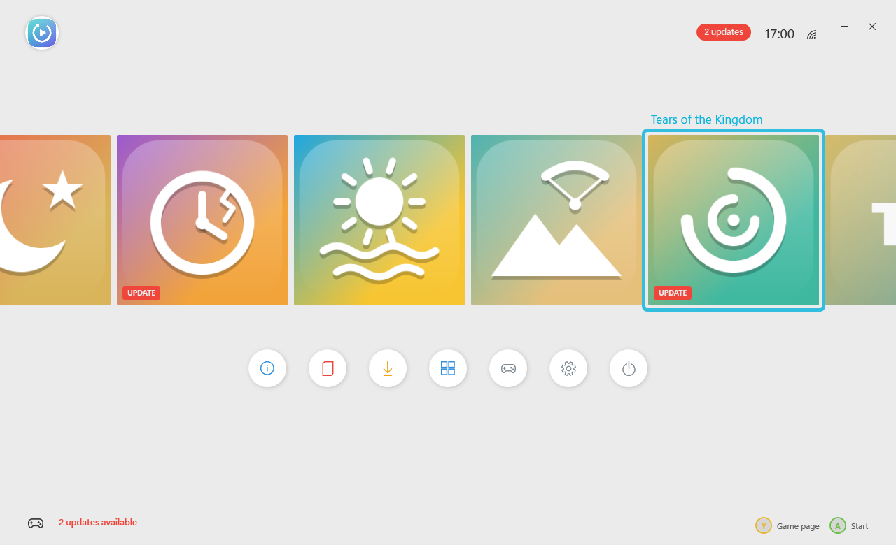

## Home screen

The launcher opens on a console-style home screen: your games as a row of big square tiles, round buttons below
(Game page, What's new, Update all, All games, Full screen, Settings, Close), the clock top right.

- **All games**: every game, with filters (All / Installed / Updates / Not installed, or LB / RB) and three
  layouts: big tiles, small tiles and a list (the layout buttons, RS, Ctrl+G or Ctrl+1 to Ctrl+3).
- **Game page**: one game's installed and latest version, status and play time, with Start / Install, Update,
  What's new, its folder, its save backups and Uninstall. Open it with Y, right-click, I or the menu key.
- Arrow keys / d-pad move, Enter / A starts the game (or installs it), Esc / B goes back. Clicking the picked tile
  again starts it.

Pick a theme in Settings: Midnight, Neon, Aurora, Ember, Sakura, Daylight (light), Graphite or Abyss.

Little console-style sounds play as you move around, pick and start games (no music). Set their volume, or turn
them off, in Settings.

## Steam, Epic Games and GOG

The launcher also shows your games from the PC stores, each store in a group of its own, with the store's artwork:

- **Steam**: your whole library (from Steam's own files on this PC, no login or key). Installed games show on Home
  too; the rest have **Install with Steam**. Start, Uninstall and updates go through Steam. A game's page shows what
  Steam counted (play time, when you last played, achievements), its size and its wide artwork behind the page.
- **Epic Games**: your library from the Epic Games Launcher's cache; Install and Start hand over to the Epic Games
  Launcher.
- **GOG**: the GOG games installed on this PC (GOG Galaxy's own library isn't read).
- All games has a pill for each store (Recomps, Steam, Epic Games, GOG) and a **Continue playing** row on top.
- **Hide** on a game page takes a game off the list; Settings > Library brings it back.
- Settings > General picks how much of each store shows (your library, installed games, or none).
- **Friends** on Home: your Steam friends who are online and what they play. It needs a Steam Web API key of your
  own (Settings > Steam friends; made at steamcommunity.com/dev/apikey).

- **Achievements** on a Steam game's page: each one with its icon, when you unlocked it and how rare it is (all of
  them with the Steam Web API key, else the part Steam keeps on this PC).

## Phone remote, Discord and more

- **Phone remote** (Settings > Phone remote): open the address it shows on your phone (same Wi-Fi), type the PIN, and
  start or close games on the PC from there.
- **Discord** (Settings > Discord): shows what you play on your Discord profile; it needs the Application ID of a
  Discord application of your own named Recomp Launcher.
- **Controller battery** by the clock and in the in-game menu (Xbox, PlayStation and Switch Pro controllers), with a
  note when it gets low.
- **ScummVM games** (Putt-Putt, Freddi Fish, Pajama Sam, Spy Fox...) get their controller support switched on each
  time they start: the stick moves the pointer, A clicks, B right-clicks.
- A short **start-up animation** (Settings > General can turn it off).

## In-game menu

While a game started from the launcher runs, the Xbox, PS or Home button (or View + Menu together) opens a menu
over it: Resume, Go to the launcher, or Close the game. Over a game in exclusive full screen the menu steps the
game aside (minimised) and Resume brings it back. To use the Xbox button with Steam running, turn off "Guide button
focuses Steam" in Steam > Settings > Controller. Settings > General > When a game starts can also close the
launcher, or have it wait in the tray and come back when the game closes.

## Profiles

Several people can share the launcher, each with their own picture, name and **saves**. Click the picture at the
top left of Home (or press LB) to see who's playing, switch, edit or add a profile; with more than one profile, the
launcher asks at start.

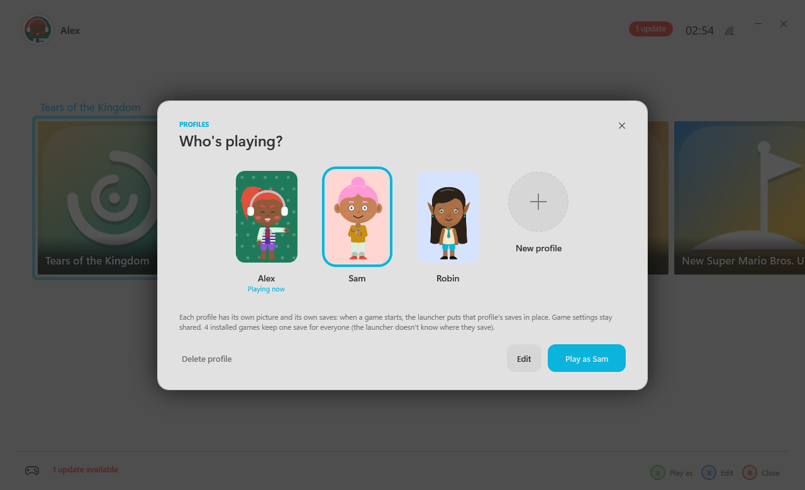

- When a game starts, the launcher puts the current profile's saves in place first: the previous player's save
  folders are copied into their own folder (`profiles\`), then the new player's are copied in (a new profile starts
  each game fresh). It's all or nothing: if anything fails, everything goes back as it was and the game doesn't start.
- Only save folders change hands. Game settings files (`.ini`, `.json`) stay shared, so a new profile doesn't have to
  set a game up again. Games whose save folder the launcher doesn't know keep one save for everyone.
- Deleting a profile only takes it off the list; its saves stay in `profiles\`.

## Personalise and the character creator

**Personalise** sets a profile's picture (the launcher's logo, a game's artwork, a picture of your own in
`avatars\`, or a character you make), its frame colour and its name.

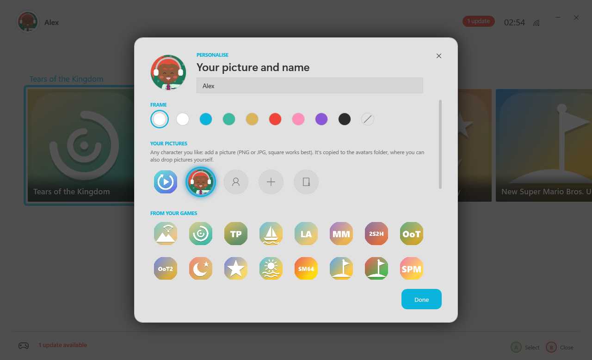

The **character creator** opens full screen. Your character stands in the middle, blinking and swaying, and the view
moves in on the face while you work on it. Every choice is shown on your own character.

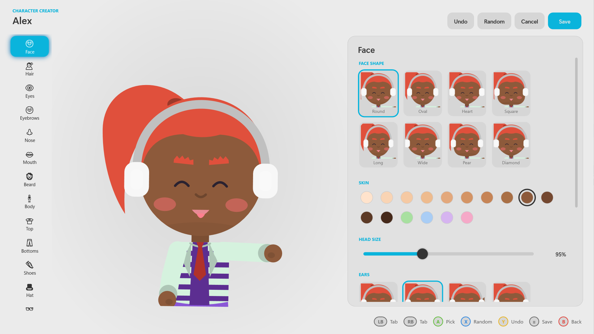

- 16 tabs: Face, Hair, Eyes, Eyebrows, Nose, Mouth, Beard, Body, Top, Bottoms, Shoes, Hat, Glasses, Extras,
  Pose and Backdrop.
- Parts to pick (22 hairstyles, 16 eye styles, 10 tops, 15 hats...) and colours for skin, hair, eyes, eyebrows,
  lips, beard, clothes and accessories.
- Sliders to size, move, space and tilt the eyes and eyebrows, size and move the nose, mouth and glasses, and set
  head size, height and build.
- A pose for the full-body picture (Who's playing?) and a mood for the round picture on Home, over a backdrop.
- Undo, Random and Save. With a controller: LB / RB change tab, A picks, left / right move a slider, X random,
  Y undo, Menu saves, B goes back.
- An easy-going lounge tune plays while it's open (written for the launcher; it follows the Sounds volume).

| | |
|---|---|
| 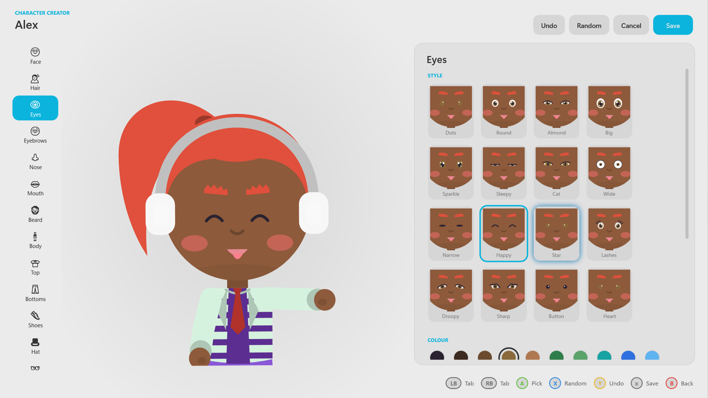 | 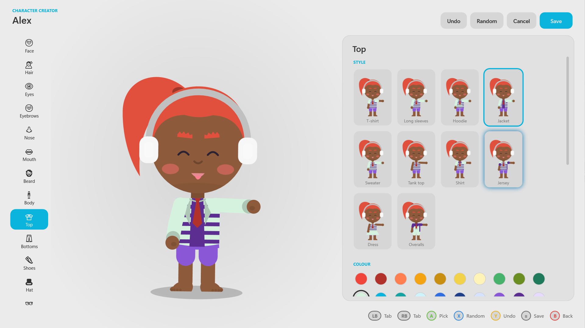 |
| Eyes: every style on your own face | Clothes, in two colours with patterns |
| 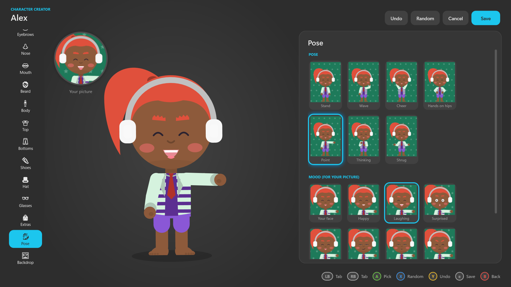 | 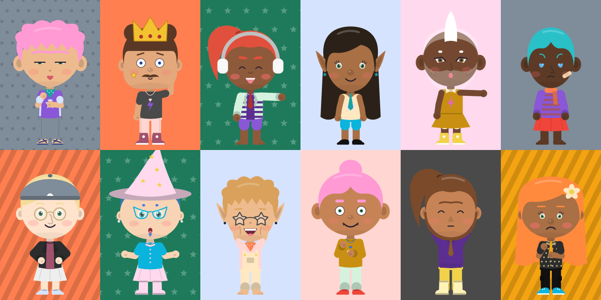 |
| Pose and mood (Graphite theme) | A dozen characters from Random |

## Screenshots

| | |
|---|---|
| 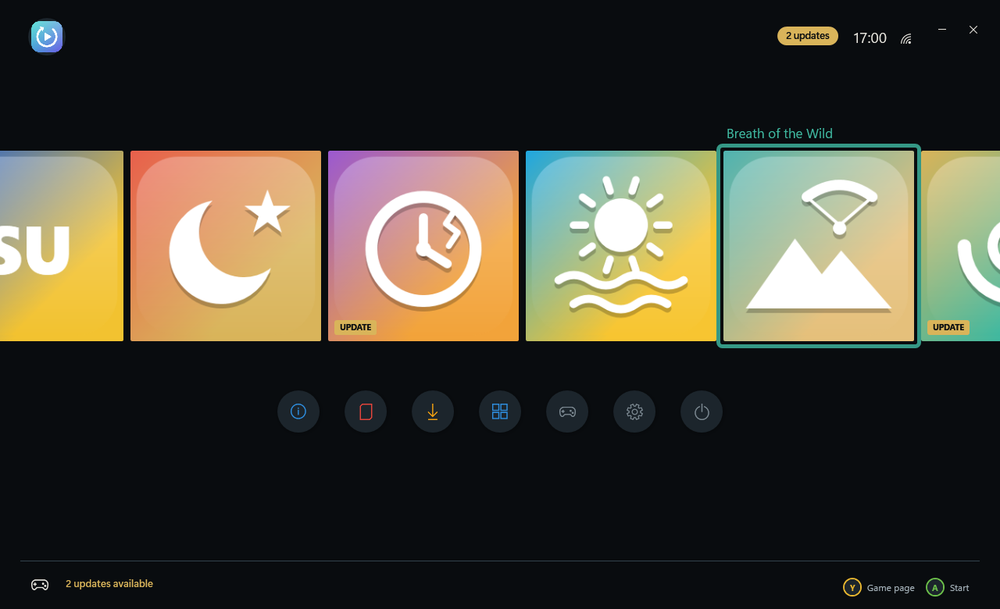 | 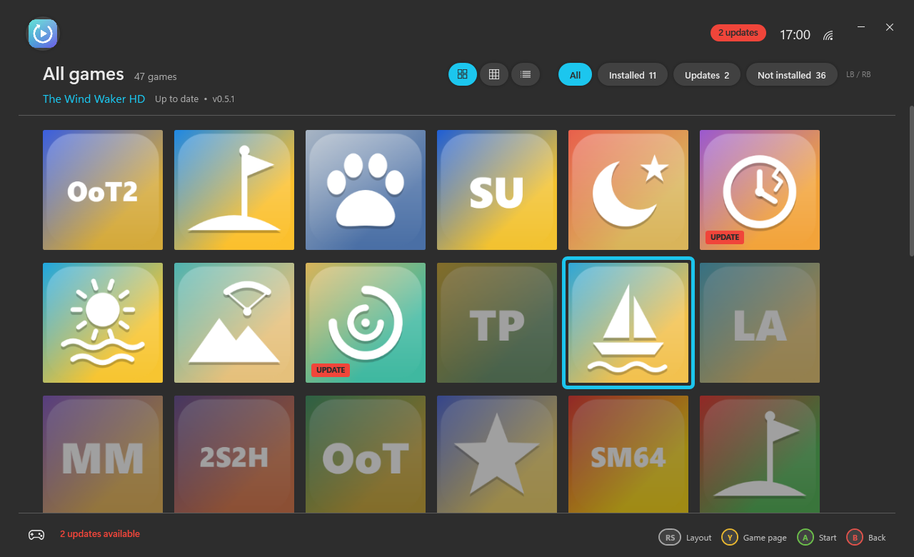 |
| Home screen (Midnight) | All games, big tiles (Graphite) |
| 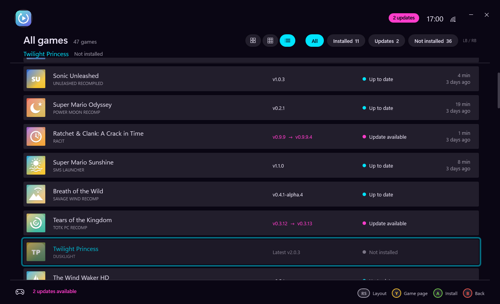 | 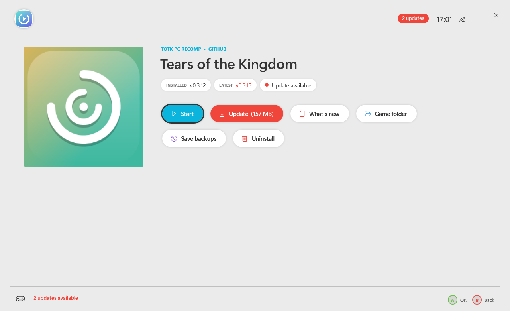 |
| All games, list (Neon) | Game page (Daylight) |
| 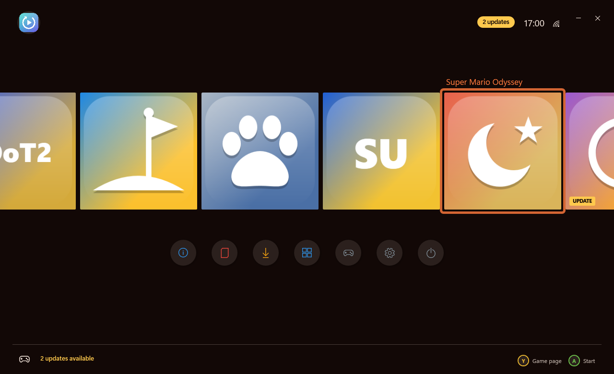 | |
| Home screen (Ember) | |

The tiles in these pictures are the launcher's own drawn ones. Put your own pictures in `icons\` to use them instead.

## Update checks

At start (and every 3 hours, or with the Check button / F5) the launcher asks GitHub for the latest release of the
games you have **installed** only. A release found in the last 20 minutes is reused instead of asking again. Games
that aren't installed are looked up only when you press Install or open their release notes.

## Install

Download `RecompLauncher-Setup-<version>.exe` from [Releases](../../releases) and run it.

- Installs for your user only (`%LOCALAPPDATA%\Programs\Recomp Launcher`), so no admin rights are needed.
- Works on a clean Windows 10/11 PC: .NET Framework 4.8, WPF and PowerShell 5.1 are part of Windows.
- Offers to install the Microsoft Visual C++ runtime if it's missing (most games need it; this step asks for admin).
- Uninstall from Settings > Apps. Your settings, play time, save backups and dumps are kept for a reinstall.

You need your own game files (dumps of games you own); the launcher doesn't provide any.

## Build

```powershell
src\build.ps1                                   # Recomp Launcher.exe (C# compiler built into Windows) and the logo/icon
installer\build-installer.ps1 -Version 2.0.0    # installer\Output\RecompLauncher-Setup-2.0.0.exe (needs Inno Setup 6)
```

`build.ps1` needs nothing to be installed: it uses the C# compiler that comes with .NET Framework 4.8.
`build-installer.ps1` copies only the files the launcher needs into `installer\stage` and refuses to build if
anything personal (settings, keys, logs, backups, dumps or a GitHub token) would end up in the installer.

## Files

| File | What it is |
|---|---|
| `Recomp Launcher.exe` | The launcher (WPF), built from `src\App` |
| `games.json` | The games: names, folders, where their releases are, what each game's setup needs |
| `recomp-worker.ps1`, `nsp-worker.ps1`, `uninstall-worker.ps1`, `playtime-worker.ps1` | Background jobs: install/update, NSP/XCI extraction, uninstall, play time |
| `tools\` | `hactool` and `nstool`, used to extract dumps |
| `installer\` | Inno Setup script and build script |

Adding a game is an entry in `games.json` (its `Asset` can list several download names, `;`-separated, the first
that a release has wins).

## Game artwork

The launcher draws its own tiles for games, and uses a game's own program icon once it's installed. No game artwork
is included. To use your own pictures, put them in `icons\` next to the launcher, named by the game's id
(for example `icons\totk.png`, `icons\smo.jpg`).
