# Recomp Launcher

One console-style home for PC recomps, decomps and native ports, and for your Steam, Epic Games and GOG games.
It shows the installed and latest release of each game, installs a game the first time from your own game files,
plays it, and updates one or all of them. Made for a controller, and it works just as well with a mouse and keyboard.

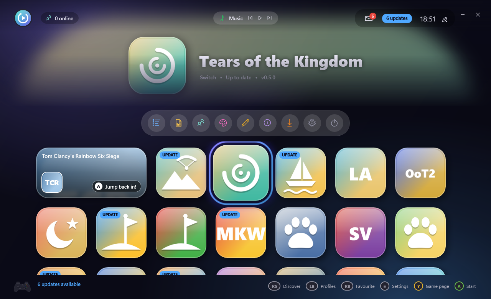

**Download:** `RecompLauncher-Setup-<version>.exe` from [Releases](../../releases). The launcher updates itself after that.

You need your own game files (dumps of games you own). The launcher doesn't come with any games and doesn't help
you get them.

## What's in it

- **216 games**: recomps and ports for N64, GameCube, Wii, Wii U, Switch, Switch 2, Xbox, Xbox 360, PS1 to PS4,
  the Game Boys, NDS, SNES and more, each installed from its own project's GitHub (or its own site) releases.
- **Your PC stores**: your Steam library (installed games on Home, Install with Steam for the rest), Epic Games and
  GOG, each with the store's artwork. Start, install and uninstall go through the store.
- **Updates**: the launcher checks the games you have installed, shows what's new in each release, and updates one or
  all with one press. Games with their own builder (Ocarina of Time on Switch 2 through Longshot) open it for you.
- **Discs and dumps**: NSP / XCI extraction, disc conversion and two-disc games (The Force Unleashed) are handled for
  you; the game page says what each game needs.

## Three looks, the same launcher

Pick a style in Settings > Theme; each has a few colour themes. Everything works the same in every style: only the
look changes.

| | |
|---|---|
|  | 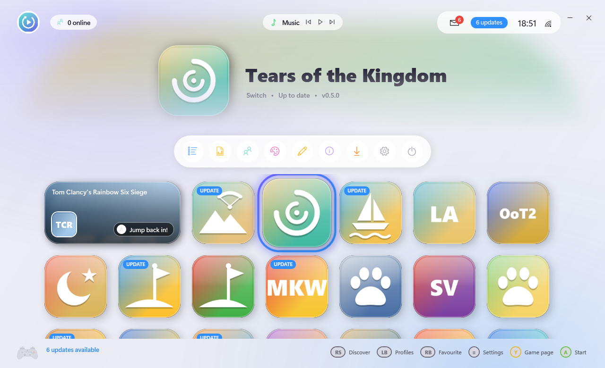 |
| **Glow** (the standard): glossy rounded icons on a soft violet glow, the picked game big at the top, a tab bar and a grid that starts with Jump back in | Glow Light |
| 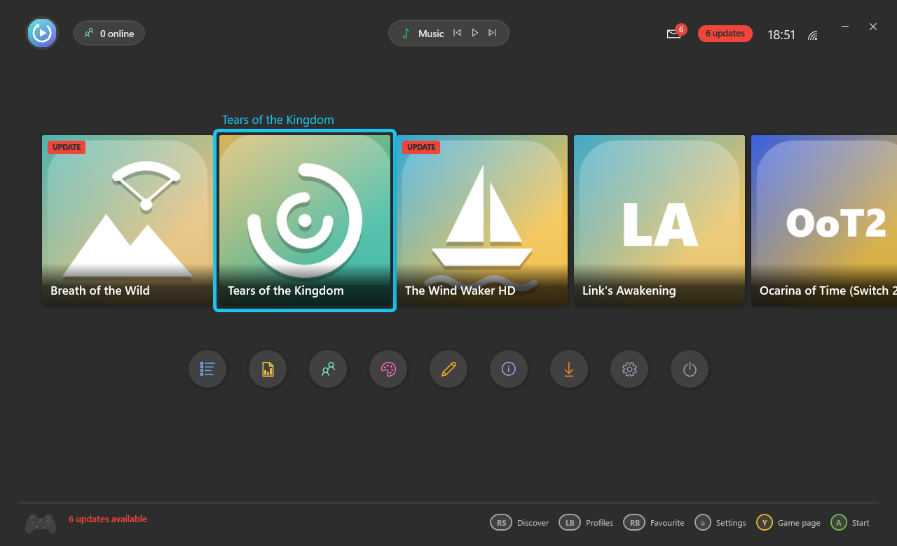 | 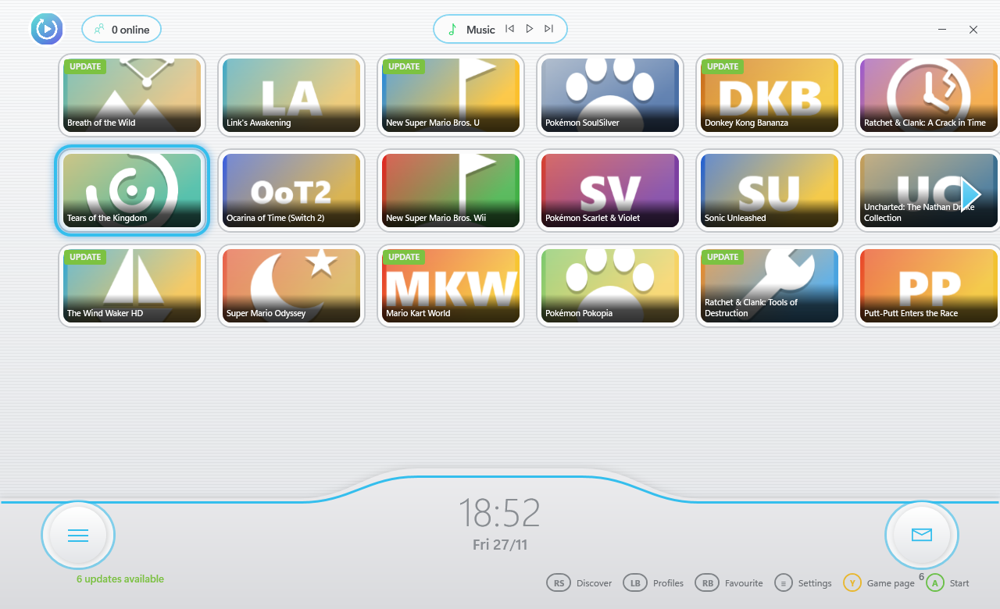 |
| **Console**: a handheld console's home screen, flat and plain, a row of big tiles with round buttons | **Channels**: white and silver channel tiles, three high, with soft blue rims |

A fourth style, **Cinema**, puts a shelf of wide tiles under a big picture of the picked game.

## The game page

Everything about one game: what's installed and what's out, its status, play time and size, Start, Update, What's
new, and the rest as tiles (its folder, save backups, Uninstall, favourite, collections, hide, achievements, test
versions, online play, Pixel art).

| | |
|---|---|
| 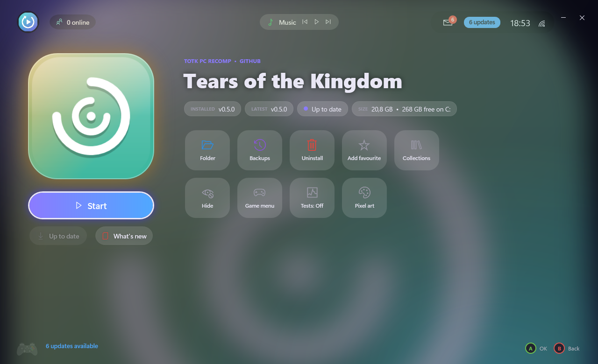 | 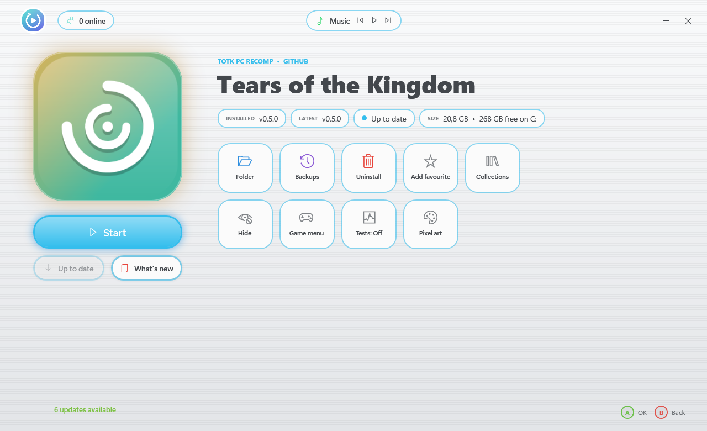 |

## Made for a controller

- Xbox, PlayStation (DualShock 4, DualSense) and Switch Pro controllers, with the right button names and colours.
  Bluetooth pairing from the launcher.
- **Every screen works with the controller**, text included: an on-screen keyboard opens wherever something has to
  be typed (a friend's code, a key, a folder).
- **In-game menu**: the Xbox, PS or Home button (or View + Menu) over a running game: resume, take a screenshot,
  music, go to the launcher, or close the game.
- **Settings > Controller** shows your controller live: every button lights up, the sticks move and the triggers fill.
  A test checks each button, how far round each stick reaches, stick drift and vibration.

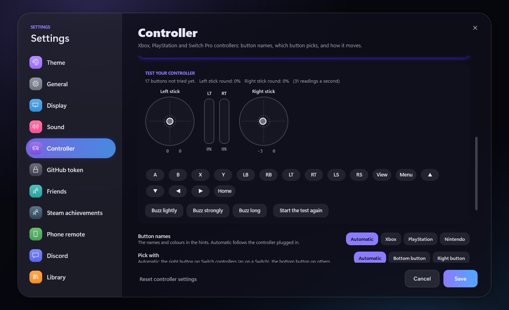

## Friends, music and more on Home

- **Friends**: everyone has a friend code; add friends by their code and see who's online and what they're playing.
- **Music**: what Spotify (or VLC, foobar2000, MusicBee, ...) is playing, with play / pause, next and previous,
  right on Home and in the in-game menu. No login: it uses the media keys.
- **Mail**: a letter for each new release of your games, and notes from the launcher.
- **Achievements**, the **Album** (screenshots from the in-game menu), a **message board**, the weather, the
  controller's battery, a **phone remote**, **Discord** status, and **online play** over Tailscale for the games that
  have it.

## Pixel art and Flip book

| | |
|---|---|
| 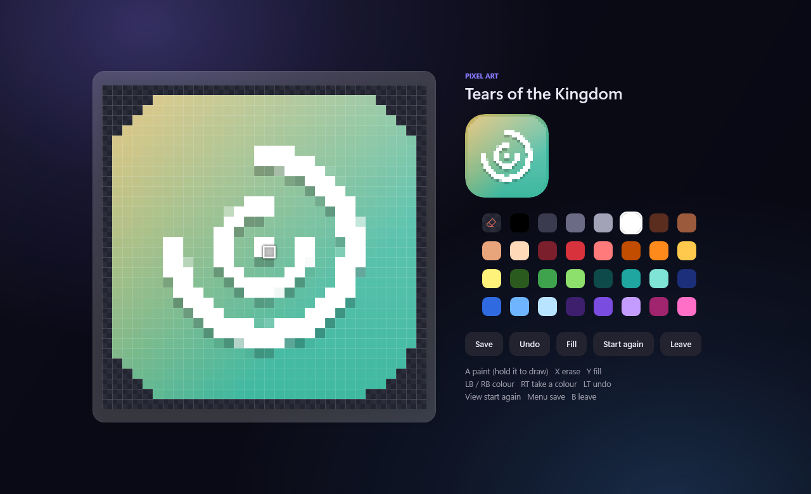 | 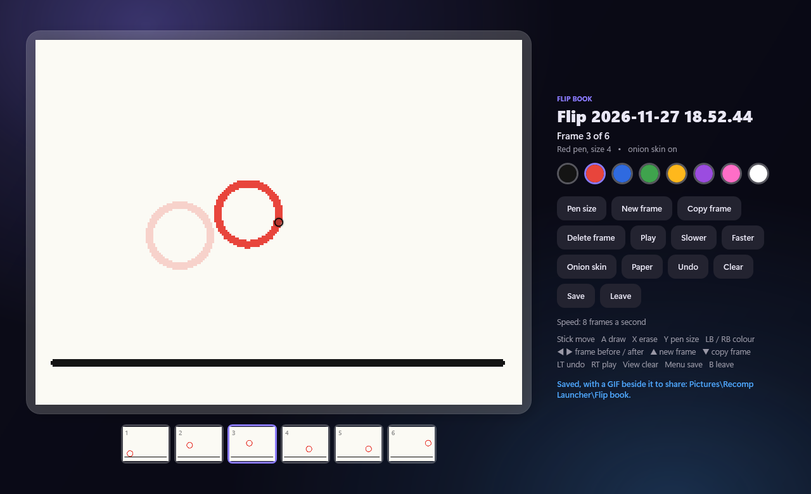 |
| **Pixel art**: draw a game's icon yourself, pixel by pixel, starting from its own icon. A, hold to draw; LB / RB colour; Y fill; RT takes a colour | **Flip book**: draw little animations frame by frame, with the frame before showing faintly underneath. Play them, and save them as GIFs |

## Profiles and characters

Several people can share the launcher, each with their own picture, name and **saves**: when a game starts, the
current profile's saves are put in place first (all or nothing: if anything fails, everything goes back as it was).

The **character creator** makes your character: 16 tabs (face, hair, eyes, clothes, hat, pose, backdrop...), parts
and colours shown on your own character, sliders, Random and Undo.

| | |
|---|---|
| 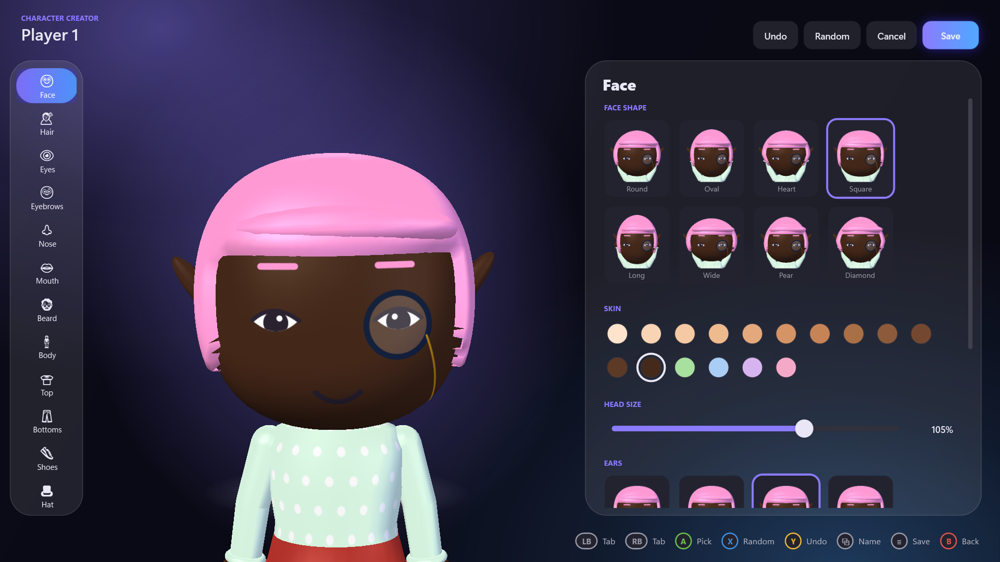 | 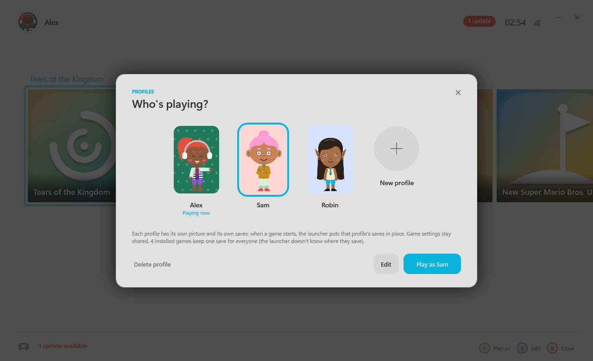 |

## TV & Movies

TV & Movies plays the channels and films of your own TV provider (your own login or playlist), with a guide, the TV
archive, subtitles and profiles. **Recomp TV** in `samsung-tv\` is the same for Samsung TVs (Tizen); see its README.

## Install

- Installs for your user only (`%LOCALAPPDATA%\Programs\Recomp Launcher`), so no admin rights are needed.
- Works on a clean Windows 10 or 11 PC: .NET Framework 4.8 and WPF are part of Windows.
- Offers to install the Microsoft Visual C++ runtime if it's missing (most games need it; that step asks for admin).
- Uninstall from Windows Settings > Apps. Your settings, play time, save backups and dumps are kept for a reinstall.

## Build

```powershell
src\build.ps1                                   # Recomp Launcher.exe (the C# compiler built into Windows) and its icon
installer\build-installer.ps1 -Version 2.5.0    # installer\Output\RecompLauncher-Setup-2.5.0.exe (needs Inno Setup 6)
```

`build.ps1` needs nothing installed: it uses the C# compiler that comes with .NET Framework 4.8.
`build-installer.ps1` copies only the files the launcher needs and refuses to build if anything personal (settings,
keys, logs, backups, dumps or a GitHub token) would end up in the installer.

Test mode, for pictures like the ones above: `"Recomp Launcher.exe" -snapshot home.png -style glow -drawnicons`
(`-padscript Y` presses buttons first, `-opensettings` opens Settings).

## Files

| File | What it is |
|---|---|
| `Recomp Launcher.exe` | The launcher (WPF), built from `src\App` |
| `games.json` | The games: names, where their releases are, what each one's setup needs |
| `recomp-worker.ps1`, `nsp-worker.ps1`, `uninstall-worker.ps1`, `playtime-worker.ps1` | Background jobs: install / update, NSP and XCI extraction, uninstall, play time |
| `tools\` | `hactool` and `nstool`, to extract dumps |
| `installer\` | The Inno Setup script and its build script |
| `server\friends\` | The friends server (a Cloudflare Worker) |
| `samsung-tv\` | Recomp TV, the TV & Movies app for Samsung TVs |

Adding a game is an entry in `games.json` (its `Asset` can list several download names, `;`-separated; the first one
a release has wins).

## Game artwork

The launcher draws its own tiles for games and uses a game's own program icon once it's installed (the pictures on
this page are the drawn ones). No game artwork is included. To use your own pictures, put them in `icons\` next to
the launcher, named by the game's id (`icons\totk.png`), or draw one in Pixel art.
